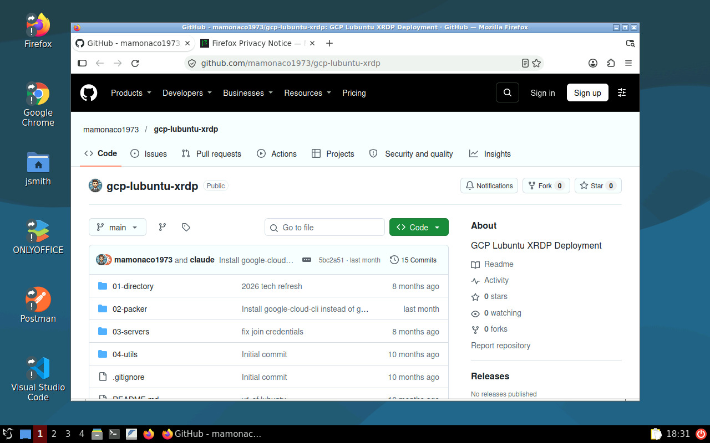
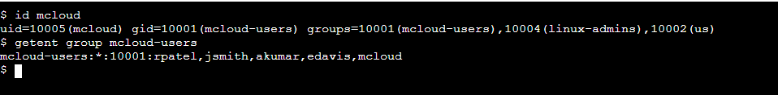

# Lubuntu XRDP Desktop + Active Directory on Google Cloud

A cloud Linux workstation for every build on the channel. A **Lubuntu**
(LXQt) desktop on
**Ubuntu 26.04 LTS**, reached over RDP (XRDP), joined to a **mini-AD** domain,
with home directories on **Filestore (NFS)**. Users sign in with their AD
account, and their files follow them to any desktop built from the same image.



| Piece | Where | Role |
|---|---|---|
| **Lubuntu desktop** | `lubuntu-subnet` | Packer-built image (LXQt + XRDP + dev tools); joined to AD with SSSD at boot; RDP and SSH from the internet |
| **Windows Server 2022** | `lubuntu-subnet` | joined to AD; RSAT for managing users; maps the desktop's `/nfs` share as `Z:` |
| **mini-AD** (Samba DC) | `lubuntu-subnet`, no external IP | users, groups, POSIX IDs, DNS, Kerberos |
| **Filestore** (Basic HDD, NFS v3) | `us-central1-b`, private IP in `lubuntu-vpc` | `/home` and the shared `/nfs` area |
| **Secret Manager** | the project | AD admin and user passwords, read by the VMs through the service account |
| **Cloud NAT** | `lubuntu-vpc` | outbound internet for the DC |

## Architecture

<picture>
  <source media="(prefers-color-scheme: dark)" srcset="architecture-dark.svg">
  
</picture>

Regenerate with `python3 make_diagram.py`.

- **`01-directory/`**: the VPC (`lubuntu-vpc`) with `lubuntu-subnet` (10.1.0.0/24),
  a Cloud Router with Cloud NAT, Secret Manager secrets with the generated
  passwords, and the
  [`module-gcp-mini-ad`](https://github.com/mamonaco1973/module-gcp-mini-ad)
  Samba DC with users and POSIX attributes from `users.json`. The DC has no
  external IP.
- **`02-packer/`**: builds the Lubuntu image (family `lubuntu-images`) from the
  `ubuntu-2604-lts-amd64` image family: LXQt with Openbox, XRDP with an LXQt session,
  the SSSD, realmd and Samba packages, and the channel's tool set
  (Chrome, Firefox, VS Code, Docker, Packer, Terraform, AWS/Azure/Google Cloud
  CLIs, Postman, KRDC, OnlyOffice). The domain join is left to boot time,
  because a computer account and keytab can't be baked into a shared image.
- **`03-servers/`**: the Filestore instance, the firewall rules, and the
  Lubuntu desktop and Windows VMs. Both VMs run as the service account from
  `credentials.json` and get their setup scripts as instance metadata.

## What's in the image

- **Snap is left as Ubuntu ships it.** Firefox is a snap. Chrome, VS Code,
  Postman and OnlyOffice come from `.deb` packages. The one snap removed is
  Google's `google-cloud-cli`, because the image installs the apt package
  instead.
- **Snaps work in an XRDP session** because `/etc/xrdp/startwm.sh` exports
  `XAUTHORITY`. XRDP starts Xorg with `-auth .Xauthority` but doesn't export
  the variable; snaps run with a redirected `$HOME`, so without it they fail
  with "Authorization required".
- **No polkit prompts in RDP sessions.** A polkit rule allows colour-profile
  and package-refresh actions that otherwise ask for a password at login.
- **No NetworkManager.** The desktop packages pull it in; the build removes
  it, pins it out of apt and masks its services, so the NIC stays with the
  netplan configuration Google's image sets up.
- **LXQt 2.3 fixes for 26.04.** The panel uses the `fancymenu` plugin
  (`mainmenu` no longer loads) with `lxqt-menu-data`, and the `dark` theme,
  because the `debian` theme draws the menu button blank. `xdg-utils` and
  `qtxdg-tools` with `XDG_CURRENT_DESKTOP=LXQt` let apps open links and
  files, and `/etc/xdg/mimeapps.list` makes Firefox the default browser.
- **Nothing a cloud desktop doesn't use.** gvfs (which hangs PCManFM-Qt in
  remote sessions), printing, Bluetooth, ModemManager and power management
  are removed, and no display manager runs on the console.
- **New users get the desktop icons and defaults** from `/etc/skel`.

## How sign-in works

1. On first boot the desktop's startup script mounts `/nfs` from Filestore
   and `/home` from its `home` directory, reads the AD admin password from
   Secret Manager, and joins the domain with `realm join`, retrying while the
   DC settles. SSSD is set for short names (`jsmith`, not
   `jsmith@mcloud.mikecloud.com`) and the POSIX IDs stored in AD. The script
   leaves `/root/.nfs_provisioned` so later boots skip it.
2. An RDP client connects to the desktop's external IP on 3389. XRDP checks
   the password through PAM and SSSD, creates the home directory on Filestore
   on first login, and starts LXQt.
3. Members of **`linux-admins`** (jsmith and rpatel) get passwordless sudo.
4. The Windows host runs `ad_join.ps1` from its instance metadata: it installs
   RSAT, reads the same secret, joins the domain, lets `mcloud-users` sign in
   over RDP, and maps the desktop's Samba share of `/nfs` as `Z:`, which holds
   this repository and the helper scripts.

| User | Groups | sudo on the desktop |
|---|---|---|
| jsmith | mcloud-users, us, linux-admins | yes |
| edavis | mcloud-users, us | no |
| rpatel | mcloud-users, india, linux-admins | yes |
| akumar | mcloud-users, india | no |

## Network security

```
internet ─3389, 22, 445─▶ Lubuntu desktop ─2049─▶ Filestore (private IP)
internet ─3389─────────▶ Windows ─445─▶ Lubuntu desktop (Z: is /nfs)
```

The `lubuntu-allow-rdp`, `lubuntu-allow-ssh` and `lubuntu-allow-smb` firewall rules open
3389, 22 and 445 from anywhere to the tagged VMs; every login still needs an
AD account. `lubuntu-allow-nfs` opens 2049 to every VM in the VPC. The DC's
`ad-ports-*` rule allows the AD ports, but the DC has no external IP, so only
traffic inside the VPC reaches it. Filestore has only a private IP.

## Prerequisites

* [A Google Cloud Account](https://console.cloud.google.com/)
* [Install gcloud CLI](https://cloud.google.com/sdk/docs/install)
* [Install Terraform](https://developer.hashicorp.com/terraform/install)
* [Install Packer](https://developer.hashicorp.com/packer/install)
* [Install jq](https://jqlang.github.io/jq/download/)

Put a service account key for your project in the repository root as
`credentials.json` (it is in `.gitignore`). `check_env.sh` signs gcloud in
with it, and `api_setup.sh` enables the Compute Engine, Secret Manager and
Filestore APIs. If this is your first time watching our content, we
recommend starting with this video:
[GCP + Terraform: Easy Setup](https://www.youtube.com/watch?v=6Pe_YkUeHEU).

Everything deploys to `us-central1` (VMs in `us-central1-a`, Filestore in
`us-central1-b`). Filestore's Basic HDD tier has a 1 TiB minimum, so tear the
lab down when you're done.

## Deploy

```bash
git clone https://github.com/mamonaco1973/gcp-lubuntu-xrdp.git
cd gcp-lubuntu-xrdp
cp /path/to/your-key.json credentials.json
./apply.sh       # 1: VPC, secrets, mini-AD  2: Lubuntu image (Packer)  3: Filestore, desktop, Windows
```

A full run takes about 30 minutes: phase 1 about 5, the Packer build 15 to
18, and phase 3 about 8, most of it Filestore. Each run of `apply.sh` builds a
fresh image, and phase 3 always uses the newest one. After phase 3, the
desktop needs about **5 minutes** to mount Filestore and join the domain, and
the Windows host about **10 minutes** to join and reboot.

`apply.sh` ends by running `validate.sh`, which prints the two hosts and a
login:

```
============================================================================
Lubuntu Quick Start - Validation Output (GCP)
============================================================================

NOTE: Windows RDP Host:      34.171.52.216
NOTE: Lubuntu Host:          136.80.107.29

NOTE: Sign in:               jsmith / stream-572318
                             Desktop: jsmith. Windows: MCLOUD\jsmith.
                             Other users: <user>-ad-credentials-lubuntu
                             in Secret Manager.
```

## Try it

1. `validate.sh` prints jsmith's password. For another user, get it from
   Secret Manager:

   ```bash
   gcloud secrets versions access latest --secret=edavis-ad-credentials-lubuntu \
     | jq -r .password
   ```

2. RDP to the **Lubuntu Host** as `jsmith`. The LXQt desktop opens, and
   jsmith's home directory is created on Filestore on first login. Try `id`,
   `getent group linux-admins`, `sudo -l` and `df -h /home`.
3. Sign out and sign in as `edavis`: the same desktop, no sudo.
4. RDP to the **Windows RDP Host** as `MCLOUD\jsmith`. **Active Directory
   Users and Computers** is installed, and `Z:` is the desktop's `/nfs`.

### Add a desktop user

1. On the Windows host, open **Active Directory Users and Computers** and turn
   on **View > Advanced Features**.
2. Under the **Users** container of `mcloud.mikecloud.com`, create the user
   (for example `mcloud`) and set a password.

   

3. Get the next free `uidNumber`: run `Z:\gcp-lubuntu-xrdp\04-utils\getNextUID.bat`.
4. In the user's **Attribute Editor**, set `uidNumber` to that value,
   `gidNumber` to `10001` (`mcloud-users`), and `uid` to the login name.
5. On **Member Of**, add `mcloud-users` (and `linux-admins` for sudo).
6. On the desktop (`ssh jsmith@<Lubuntu Host>`), `id mcloud` shows the new
   IDs and groups.

   

7. RDP to the desktop as the new user.

   

## Troubleshooting

| Symptom | Fix |
|---|---|
| RDP rejects every AD password | The desktop hasn't finished its domain join. Read the startup script's output: `gcloud compute instances get-serial-port-output <vm> --zone us-central1-a \| grep startup-script`, and `/root/userdata.log` and `/root/join.log` on the VM. |
| `/root/join.log` ends in `realm join failed (10/10)` | Check that the DC is running and that the desktop resolves `mcloud.mikecloud.com` to it. |
| `/nfs` is empty or `/home` is missing | `findmnt /nfs` on the desktop. `gcloud filestore instances list` shows the share's IP, which must match `/etc/fstab`. |
| RDP connects, then closes | Check `/var/log/xrdp-sesman.log` and `~/.xsession-errors` on the desktop. The session runs `/etc/xrdp/startwm.sh`, which starts LXQt. |
| Firefox takes a while to open the first time | Expected on a fresh VM: the snap sets itself up on first use. Later launches are quick. |
| A snap app won't open its window | `echo $XAUTHORITY` in the session should print an absolute path. If not, `/etc/xrdp/startwm.sh` is missing the export. |
| `id <user>` finds nothing | The user needs `uidNumber`, `gidNumber` and `uid` set in AD. SSSD caches lookups; `sudo sss_cache -E` clears it. |
| `Z:` is missing on Windows | The Windows host joins the domain and reboots after deploy; give it about 10 minutes. |
| `apply.sh` fails on an API | `api_setup.sh` enables the APIs, but a newly enabled API can take a few minutes to work. Run `apply.sh` again. |

## Teardown

```bash
./destroy.sh     # destroys phase 3, deletes the Lubuntu images, destroys phase 1
```

## Notes

- **Lab only.** RDP, SSH and SMB are open to the internet, and the join uses
  the domain admin account. Restrict the firewall rules and use a dedicated
  join account for anything more.
- Users, groups and POSIX IDs are defined in
  `01-directory/scripts/users.json.template`.
